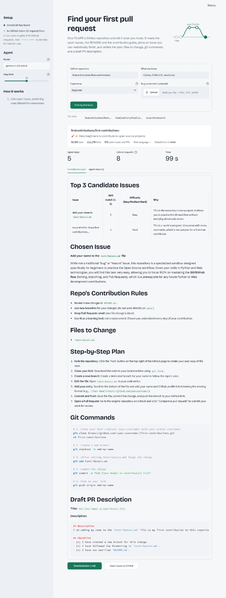

# 🔀 FirstPR Agent

**An AI agent that turns "I want to contribute to open source but don't know where to start" into a ready-to-follow plan.**

Give it any GitHub repository and your skills. A **Gemma 4** agent explores the repo on its own: it reads open issues, the README and the contribution guide, picks the issue that fits *you*, and writes a complete plan covering which issue, which files, what to change, the exact git commands, and a draft PR description.


-blue)


> 🌐 **Live demo:** https://firstpr-agent.streamlit.app *(replace with your deployed URL)*
>
> Built at **Hacktoberfest Hack Day Lahore × AWS Student Builder Group, Virtual University of Pakistan** (17 Oct 2026).
> Entered in **Best Use of Gemma 4** (Google DeepMind) and **Best Open-Source AI Project** (DigitalOcean).

---

## 📸 It works: a real run

A real run on [`firstcontributions/first-contributions`](https://github.com/firstcontributions/first-contributions) for a **beginner** who knows Python, HTML/CSS and JavaScript:



| Agent steps | GitHub requests | Time |
|---|---|---|
| **5** | **8** | **99 s** |

In 5 steps, the agent:
- ranked the top candidate issues by skill match and difficulty, and **rejected** a long "work in progress" discussion as too complex for a first-timer
- read the repo's own rules (don't edit README.md, use a new branch, keep PRs small) and put them in the plan
- found the real file to change (`Contributors.md`), with no invented files
- wrote the step-by-step plan, the exact git commands, and a draft PR description with a checklist

All within GitHub's unauthenticated limit: 8 requests out of 60 per hour.

## 😟 The problem

Hacktoberfest is many students' first step into open source, and it's where most of them get stuck:

- They open a big repository with hundreds of issues and **don't know which one they can actually do**.
- They don't know **which files to change** or what the project's **contribution rules** are.
- They don't know the **git workflow** or how to write a good PR description.

So they either give up, or they send low-quality PRs (adding their name, changing one word) that frustrate maintainers. Both outcomes hurt open source.

## 💡 The solution

FirstPR Agent acts like a senior developer sitting next to you. You tell it:

1. **A repository**: `owner/repo`, a full GitHub URL, or a clone URL
2. **What you know**: e.g. "Python, HTML/CSS"
3. **Your level**: Beginner or Intermediate
4. *(Optional)* **A bug screenshot**, if you've hit a bug in that project

…and it explores the repository **by itself** and gives you a plan with these sections:

| Section | What you get |
|---|---|
| **Top 3 Candidate Issues** | A table ranking issues by skill match (1–5) and difficulty, with reasons |
| **Chosen Issue** | The best fit for you, with a link and why it suits you |
| **Repo's Contribution Rules** | The project's own rules, from its CONTRIBUTING guide |
| **Files to Change** | Real files from the repository, never invented |
| **Step-by-Step Plan** | What to do, in order |
| **Git Commands** | Fork, clone, branch, commit, push, ready to copy |
| **Draft PR Description** | A good PR description you can paste |

You can **download the plan as Markdown** and keep it next to your editor.

## 🤖 How the agent works

This is a real **tool-using agent**, not a single prompt. Gemma 4 decides what to look at next, step by step, based on what it has already found.

```
 You: repo + skills + level (+ screenshot)
                  │
                  ▼
  ┌──────────────────────────────────┐
  │ Pre-checks (no AI cost)          │  repo exists? archived? issues enabled?
  └──────────────────────────────────┘
                  │
                  ▼
  ┌──────────────────────────────────┐
  │ (optional) Gemma 4 VISION reads  │  "TypeError on login page in Chrome…"
  │ your bug screenshot              │
  └──────────────────────────────────┘
                  │
                  ▼
  ┌──────────────────────────────────┐
  │ Agent loop (Gemma 4)             │◄──────┐
  │ "What should I look at next?"    │       │ tool result
  └──────────────────────────────────┘       │
          │ picks one tool                   │
          ▼                                  │
  list_issues · read_issue · read_readme ·   │
  read_contributing · list_files · read_file ┘
          │
          ▼  (when it has enough)
  Final plan in Markdown → shown + downloadable
```

### The agent's tools (all read-only)

| Tool | What it does |
|---|---|
| `list_issues()` | Open issues, prioritizing `good first issue`, then `help wanted` |
| `read_issue(number)` | Title, labels, assignment status and body of one issue |
| `read_readme()` | The repository's README |
| `read_contributing()` | The CONTRIBUTING guide, if the repo has one |
| `list_files(path)` | Files in a folder |
| `read_file(path)` | The first 3,000 characters of a file |

### How the agent is kept on track

- **Smart issue choice:** skips issues that are already assigned, have long debates, or need architecture changes; prefers docs, tests and small isolated fixes for beginners.
- **Follows the repo's own rules:** always reads the contribution guide and puts those rules in your plan.
- **No hallucinated files:** instructed to use only what the tools returned, and to say honestly when it can't find something.
- **No loops:** repeated tool calls return a cached result with a note, and a step limit (adjustable, default 10) forces a final answer.
- **Robust parsing:** if the model replies with invalid JSON, it's asked to retry, with a stricter template after repeated failures.
- **Safe by design:** every tool is **read-only**, and the repository is always the one *you* entered. The model can't choose a different repo.

## ✨ Features

- 🔗 Accepts `owner/repo`, full GitHub URLs, or clone URLs
- ✅ Checks the repo exists, isn't archived, and has issues **before** spending any model calls
- 🖼️ **Multimodal:** upload a bug screenshot; Gemma 4 reads it and prefers matching issues
- 📺 **Live timeline:** watch each step the agent takes, its reasoning, and what each tool returned
- 📊 Run stats: agent steps, GitHub requests used, time taken
- 💾 Plan stays on screen after downloading, and downloads as Markdown
- 🔁 Retries with backoff for model and GitHub errors; clear messages for rate limits
- 🎚️ Adjustable model and step limit from the sidebar

## 🧠 Why Gemma 4

- **Open weights:** the whole stack is open. Anyone can run it, study it, or self-host the model.
- **Multimodal:** the same model reads code and text from the repo *and* images (bug screenshots).
- **Efficient enough for agents:** an agent makes many model calls per run. `gemma-4-26b-a4b-it` is a mixture-of-experts model with about 4B active parameters, so multi-step runs stay fast.

Default model: `gemma-4-26b-a4b-it` via the Gemini API. You can change it in the sidebar or with the `MODEL` setting.

## 🚀 Run it locally

**Requirements:** Python 3.10+ and a free Gemini API key from [Google AI Studio](https://aistudio.google.com/apikey).

```bash
# 1. Get the code
git clone https://github.com/YOUR_USERNAME/firstpr-agent.git
cd firstpr-agent

# 2. (Recommended) create a virtual environment
python -m venv venv
venv\Scripts\activate            # Windows
# source venv/bin/activate       # macOS / Linux

# 3. Install dependencies
pip install -r requirements.txt

# 4. Add your keys
copy .streamlit\secrets.toml.example .streamlit\secrets.toml    # Windows
# cp .streamlit/secrets.toml.example .streamlit/secrets.toml    # macOS / Linux
```

Open `.streamlit/secrets.toml` and fill in:

```toml
GEMINI_API_KEY = "your-gemini-api-key"

# Optional but recommended (see below)
GITHUB_TOKEN = "github_pat_..."

# Optional: change the model
# MODEL = "gemma-4-26b-a4b-it"
```

```bash
# 5. (Optional) check your key and model work
python check_model.py

# 6. Run
streamlit run app.py
```

The app opens at `http://localhost:8501`. The sidebar shows whether your keys were found.

> 🔒 `secrets.toml` is in `.gitignore`. **Never commit real keys.** Keys can also be set as environment variables (`GEMINI_API_KEY`, `GITHUB_TOKEN`, `MODEL`).

### Why add a GitHub token?

Without a token, GitHub allows **60 API requests per hour per IP address**, and one run uses about 8–15. On shared Wi-Fi (like at a hackathon), that limit runs out fast. A token raises it to **5,000/hour**.

To create one: **GitHub → Settings → Developer settings → Personal access tokens → Fine-grained tokens → Generate new token**, with **Public repositories (read-only)** and no extra permissions.

## ☁️ Deploy on Streamlit Community Cloud (free)

1. Push the repo to GitHub (public).
2. Go to [share.streamlit.io](https://share.streamlit.io) → sign in with GitHub → **Create app**.
3. Choose the repo, branch `main`, main file `app.py`.
4. Open **Advanced settings**, choose Python **3.12**, and paste into **Secrets**:
   ```toml
   GEMINI_API_KEY = "your-gemini-api-key"
   GITHUB_TOKEN = "github_pat_..."
   ```
5. Click **Deploy**. The app is live in a few minutes.

## 🧪 Tests

```bash
python -m unittest discover tests
```

**15 offline tests**, with no network and no API keys needed. GitHub and the model are faked. They cover:
- repository input normalization (`owner/repo`, URLs, clone URLs)
- GitHub API error handling and rate-limit messages
- JSON extraction from messy model replies (code fences, extra text)
- cleaning and formatting the final plan
- the full agent loop: tool calls, repeated-call caching, invalid replies, step limits and forced final answers

## 📁 Project structure

| File | What it does |
|---|---|
| `app.py` | Streamlit UI: inputs, live agent progress, results, downloads |
| `agent.py` | The agent loop, prompt and JSON parsing. No UI code, so it's fully testable |
| `github_tools.py` | Read-only GitHub API tools with retries, size limits and rate-limit handling |
| `ui.py` | Styles and HTML render helpers |
| `check_model.py` | Quick check that your API key and model respond |
| `tests/test_core.py` | Offline unit tests |
| `.streamlit/config.toml` | Theme and upload settings |
| `.streamlit/secrets.toml.example` | Template for your keys |

## 🛠️ Tech stack

- **Gemma 4** (`gemma-4-26b-a4b-it`), open-weights, via the **Gemini API** (`google-genai` SDK)
- **Python** + **Streamlit**
- **GitHub REST API** (read-only)
- **unittest** for offline tests

## 🗺️ Roadmap

- **Self-hosted mode** with a local Gemma 4 through Ollama
- **Urdu and Roman Urdu plans** for students more comfortable in their first language
- **Follow-up mode:** paste your PR link and get review feedback before submitting
- **Progress tracking** across multiple contributions

## 👥 Team

Built by **Maryam Shafique** at Hacktoberfest Hack Day Lahore 2026.

## 📄 License

[MIT](LICENSE): free to use, modify and share.
